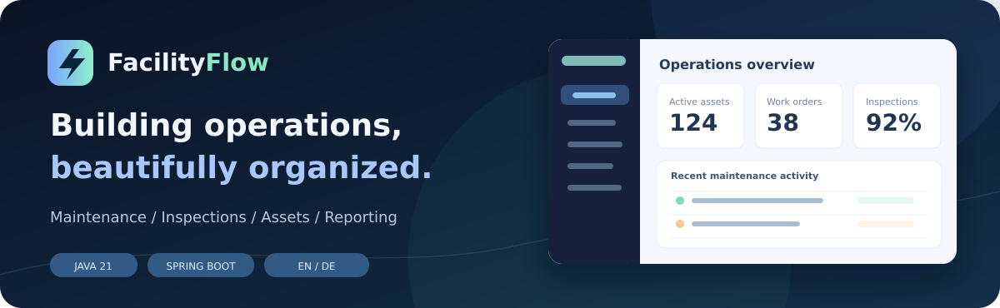

<div align="center">



# FacilityFlow
### Moderne, zweisprachige Plattform für Wartung, Inspektion und Gebäudebetrieb

**Spring Boot 3.5 · Java 21 · PostgreSQL 16 · Spring Security · Flyway · PDFBox · Docker · JUnit/Testcontainers**

[**English**](README.md) · [**Deutsche Dokumentation**](docs/de/INDEX.md) · [**Interaktive Demo**](https://ahadporkar.github.io/facilityflow/?preview=1) · [**Portfolio**](https://ahadporkar.com/)

</div>

> [!NOTE]
> Der GitHub-Pages-Demolink funktioniert **erst nach** Veröffentlichung als Repository `ahadPorkar/facilityflow` und Aktivierung von GitHub Pages mit **GitHub Actions** als Quelle. Lokal ist die Demo unter `http://localhost:5500/?preview=1` erreichbar.

## Projektidee

Technische Gebäudedienstleister verwalten Standorte, Anlagen, Prüftermine, Wartungsaufträge, Techniker, festgestellte Mängel und Freigaben. FacilityFlow verbindet diese bisher oft getrennten Tätigkeiten zu einem nachvollziehbaren Workflow.

Das Projekt ist eine **Open-Source-Referenzimplementierung für ein Entwicklerportfolio**, kein zertifiziertes System für rechtsverbindliche Prüfungen. Es demonstriert Java-Architektur, sichere Rollen- und Mandantenprüfung, Datenmodellierung, Transaktionslogik, Internationalisierung, Tests und Deployment.

## Funktionsumfang

| Modul | Implementierte Funktion |
|---|---|
| Anmeldung & Benutzer | BCrypt-Passwörter, HTTP-only-Session, CSRF-Schutz, vier Rollen, Benutzerverwaltung durch Administratoren |
| Standorte | Mandantenbezogene Gebäude- und Standortverwaltung einschließlich Anschrift und Ansprechpartner |
| Anlagen | Geräte- und Anlagenkataster mit Typ, Standort, Seriennummer und Zustand |
| Wartungsplanung | Intervalle in Tagen, Fälligkeit, täglicher Job, idempotente Erstellung von Wartungsaufträgen |
| Arbeitsaufträge | Erstellen, Zuweisen, Starten, Abschließen, Freigeben oder Stornieren mit serverseitiger Statuslogik |
| Prüfungen | Prüflistenvorlagen je Anlagenkategorie, vollständige Antworten, Ergebnis-Snapshots |
| Mängel | Fehlgeschlagene Prüfung erzeugt Mängel und verknüpften Korrekturauftrag; dessen Freigabe schließt Mängel |
| PDF-Berichte | Herunterladbare Prüf- und Arbeitsauftragsberichte auf Deutsch oder Englisch |
| Kennzahlen | Dashboard, überfällige Aufträge, Statusverteilung und aktuelle Aktivitäten |
| Audit-Protokoll | Mandantenbezogene Protokollierung geschäftlicher Änderungen und Zustandswechsel |
| Oberfläche | Responsives Dashboard, Suchfunktion, Detailansichten und Formulare, Sprachwechsel EN/DE |
| Öffentliche Demo | Interaktive lokale Beispieldaten im Browser, ohne Serveranmeldung und ohne echte Kundendaten |

## Start mit Docker

Voraussetzung: Docker Desktop oder Docker Engine mit Compose v2.

```bash
git clone https://github.com/ahadPorkar/facilityflow.git
cd facilityflow
cp .env.example .env
# In .env ein starkes DB_PASSWORD eintragen.
docker compose up --build -d
```

Anschließend **http://localhost:8080** öffnen. Mit der bereitgestellten `.env.example` sind ausschließlich für die **lokale Entwicklungsumgebung** Beispieldaten aktiviert:

- E-Mail: `demo@facilityflow.local`
- Kennwort: `DemoPass123!`

> [!WARNING]
> Niemals öffentliche Umgebungen mit Demo-Benutzern oder diesem Kennwort betreiben. Produktive Einstellungen: `APP_DEMO_SEED=false`, eigenes Administrator-Konto mittels `APP_BOOTSTRAP_EMAIL` und `APP_BOOTSTRAP_PASSWORD`, HTTPS und `SESSION_COOKIE_SECURE=true`. Siehe [Sicherheit](docs/de/SECURITY.md).

Beenden mit `docker compose down`; `docker compose down --volumes` **löscht die lokale Datenbank**.

## Entwicklerstart

Java 21, Maven 3.9+ und PostgreSQL 16 bereitstellen. Datenbank `facilityflow` anlegen und Umgebungsvariablen konfigurieren:

```bash
export SPRING_DATASOURCE_URL=jdbc:postgresql://localhost:5432/facilityflow
export SPRING_DATASOURCE_USERNAME=facilityflow
export SPRING_DATASOURCE_PASSWORD=your-password
export APP_DEMO_SEED=true
mvn spring-boot:run
```

Die Datenbankstruktur wird durch Flyway angelegt und durch Hibernate nur validiert.

### Statische Demo ohne Java und Datenbank

```bash
cd src/main/resources/static
python3 -m http.server 5500
```

Aufruf: **http://localhost:5500/?preview=1**. Änderungen werden ausschließlich im `localStorage` des Browsers gespeichert; über die Oberfläche können sie zurückgesetzt werden. Standardsprache ist Englisch, Deutsch steht über **DE** zur Verfügung.

## Tests

```bash
npm run check:js    # Node.js 22+, keine NPM-Pakete nötig
mvn verify          # Java 21 + Maven + Docker für Testcontainers/PostgreSQL
```

GitHub Actions führt beide Prüfungen bei Pull Requests und Pushes aus. Enthalten sind Integrationsprüfungen für Anmeldung, Berechtigungen, Mandantentrennung, Standorte, Anlagen, Wartungswiederholung, Auftragsstatus, Prüfungen, Mängel, Kennzahlen, PDF-Berichte, Benutzer und Audit-Protokoll. [Testkonzept →](docs/de/TESTING.md).

## Architektur und Bereitstellung

FacilityFlow ist ein modularer Spring-Boot-Monolith. Controller validieren Anfragen, Services setzen Geschäftsregeln transaktional durch, JPA-Repositories fragen mandantenbezogen ab. PostgreSQL sichert Referenzen und Eindeutigkeit; Flyway verwaltet die SQL-Migrationen. Die zweisprachige Oberfläche wird direkt von Spring Boot ausgeliefert.

- **GitHub Pages:** kostenloser öffentlicher **Frontend-Demomodus** mit synthetischen Daten. Ohne Spring Boot/PostgreSQL. Nach Veröffentlichung des Repositories in den Pages-Einstellungen „GitHub Actions“ auswählen.
- **VPS mit Docker Compose und Caddy:** echte Anwendung mit privater PostgreSQL-Datenbank und HTTPS-Reverse-Proxy.
- **Railway oder vergleichbare Plattform:** containerbasierte Bereitstellung mit separatem PostgreSQL-Dienst und sicher konfigurierten Umgebungsvariablen.

[Architektur](docs/de/ARCHITECTURE.md) · [Deployment-Anleitung](docs/de/DEPLOYMENT.md) · [API-Vertrag](docs/de/API.md).

## Vollständige zweisprachige Dokumentation

- [Dokumentationsübersicht](docs/de/INDEX.md) / [English index](docs/en/INDEX.md)
- [Anforderungen](docs/de/REQUIREMENTS.md) / [Requirements](docs/en/REQUIREMENTS.md)
- [Architektur](docs/de/ARCHITECTURE.md) / [Architecture](docs/en/ARCHITECTURE.md)
- [API](docs/de/API.md) / [API](docs/en/API.md)
- [Deployment](docs/de/DEPLOYMENT.md) / [Deployment](docs/en/DEPLOYMENT.md)
- [Sicherheit](docs/de/SECURITY.md) / [Security](docs/en/SECURITY.md)
- [Tests](docs/de/TESTING.md) / [Testing](docs/en/TESTING.md)
- [Roadmap](docs/de/ROADMAP.md) / [Roadmap](docs/en/ROADMAP.md)
- [**11 Modulhandbücher auf Deutsch**](docs/de/modules/) / [**11 module guides in English**](docs/en/modules/)

## Grenzen und nächster Ausbauschritt

Nicht implementiert sind unter anderem SSO/MFA, E-Mail-/SMS-Versand, Offline-Synchronisation, manipulationssichere Langzeitarchivierung, qualifizierte elektronische Signaturen, automatische Backup-/Restore-Prozesse und rechtlich geprüfte Aufbewahrungsfristen. Diese Themen sind ausdrücklich in der [Roadmap](docs/de/ROADMAP.md) aufgeführt; bestehende Funktionen werden nicht als behördlich zertifiziert dargestellt.

## Autor und Lizenz

**Ahad Porkar** · [GitHub](https://github.com/ahadPorkar) · [Portfolio](https://ahadporkar.com/)

MIT-Lizenz – siehe [LICENSE](LICENSE). Beiträge über Pull Requests sind willkommen.
