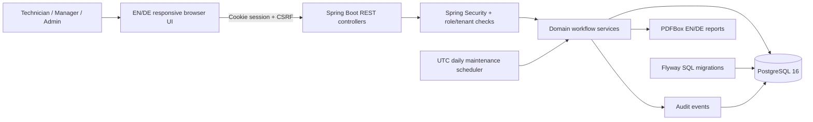

<div align="center">


# FacilityFlow
### A modern, bilingual maintenance & inspection operations platform

**Spring Boot 3.5 · Java 21 · PostgreSQL 16 · Spring Security · Flyway · PDFBox · Docker · JUnit/Testcontainers**

[**English documentation**](docs/en/INDEX.md) · [**Deutsche Dokumentation**](README.de.md) · [**Explore the interactive demo**](https://ahadporkar.github.io/facilityflow/?preview=1) · [**Author's portfolio**](https://ahadporkar.com/)

</div>

> [!NOTE]
> **Interactive demo:** The GitHub Pages link becomes available **only after** this repository is published as `ahadPorkar/facilityflow` and GitHub Pages is enabled with **GitHub Actions** as the source. You can explore the same demo locally without Java or a database by opening `http://localhost:5500/?preview=1` from a static server.

## Why this project exists

Facility managers coordinate buildings, technical installations, recurring safety inspections, maintenance technicians, defects, approvals, and inspection records. A spreadsheet or PDF cannot reliably manage the *whole* process. FacilityFlow shows how to convert it into a traceable enterprise workflow, using a modern Java back end and a deliberate, responsive user interface.

This is an **open-source portfolio/reference application**, not a certified regulatory product. It is intentionally designed to showcase system design, secure authorization, relational modeling, transactional business rules, localization, automated testing, and deployment.

## Product at a glance

| Module | Delivered behavior |
|---|---|
| Authentication & teams | BCrypt login, HTTP-only session, cookie-backed CSRF, administrator-managed accounts, four roles |
| Buildings | Tenant-scoped property/site registry, addresses and contact information |
| Equipment/assets | Equipment taxonomy, location, serial numbers, condition, owner site |
| Preventive maintenance | Recurrence by days, next due date, daily scheduler, idempotent work-order generation |
| Work orders | Create, assign, start, complete, approve, cancel; server-enforced state machine |
| Inspections | Checklists by asset category, mandatory complete answers, immutable result snapshots |
| Defects | Failures create defects and a linked corrective work order; approval resolves findings |
| Reports | Downloadable English or German PDF reports for inspections and work orders |
| Insights | KPIs, work-order status distribution, overdue counts, latest activity |
| Audit history | Tenant-filtered event records for business modifications and transitions |
| User experience | Elegant responsive dashboard, searchable lists, detail drawers, forms, EN/DE language toggle |
| Interactive preview | Realistic synthetic data with fully interactive browser-local workflows; no server credentials needed |

## User experience

The UI features a high-contrast dark sidebar, editorial typography, clear information hierarchy, responsive KPI cards, rich work-order state indicators, and interactive forms. **English is the default**; select **DE** in the header or sign-in page to switch to German. Preference is retained locally.

The static showcase intentionally uses browser-local sample data, which allows hiring teams to click through the product without risking real customer information. The production application uses authenticated APIs and PostgreSQL. **Preview data is not a substitute for server-side authorization or persistence.**

## Architecture



**Architectural decisions:** package-by-layer modular monolith; UUID-based entities; explicit organization IDs in all business records; public API request DTOs never accept an organization ID; business authorization and valid transitions enforced in services; migrations are the schema source of truth; no JPA auto schema mutation. [Details →](docs/en/ARCHITECTURE.md).

## Run locally with Docker (full application)

Requirements: Docker Engine / Docker Desktop with Compose v2. The build downloads Maven dependencies and a JDK automatically.

```bash
git clone https://github.com/ahadPorkar/facilityflow.git
cd facilityflow
cp .env.example .env
# Edit .env and choose a strong DB_PASSWORD.
docker compose up --build -d
docker compose ps
```

Open **http://localhost:8080**. With the provided **local-only** `.env.example`, demo seeding is enabled. Use:

| Local demo login | Value |
|---|---|
| Email | `demo@facilityflow.local` |
| Password | `DemoPass123!` |

> [!WARNING]
> **Never publish the demo password or seed demo users on a public live server.** For a real deployment use `APP_DEMO_SEED=false`, a unique `APP_BOOTSTRAP_EMAIL`, a strong `APP_BOOTSTRAP_PASSWORD`, HTTPS, `SESSION_COOKIE_SECURE=true`, and private PostgreSQL networking. Public production readiness also requires the hardening described in [Security](docs/en/SECURITY.md).

Stop:

```bash
docker compose down                # retain the PostgreSQL volume
docker compose down --volumes      # deletes the local database — destructive
```

### Run from source (Java / Maven)

```bash
# Java 21, Maven 3.9+, PostgreSQL 16 required.
createdb facilityflow     # or create the database using psql/your PostgreSQL client
export SPRING_DATASOURCE_URL=jdbc:postgresql://localhost:5432/facilityflow
export SPRING_DATASOURCE_USERNAME=facilityflow
export SPRING_DATASOURCE_PASSWORD=your-password
export APP_DEMO_SEED=true
mvn spring-boot:run
```

Flyway applies `V1__init.sql` automatically. Open http://localhost:8080.

### Try just the public browser demo

```bash
cd src/main/resources/static
python3 -m http.server 5500
```

Visit **http://localhost:5500/?preview=1**. Sample workflows can be modified; changes live in your browser's local storage and can be reset from the UI. No Java/PostgreSQL is involved in this mode.

## Tests & quality gates

```bash
# Requires Node.js 22+, no npm dependencies or bundler.
npm run check:js

# Requires Java 21 + Maven + Docker (Testcontainers launches real PostgreSQL 16).
mvn verify
```

CI (`.github/workflows/ci.yml`) automatically runs both on pushes and pull requests. The test suite covers login, authorization, tenant isolation, buildings, assets, recurrence/idempotency, work-order transitions, checklists, inspection failures, defects, KPIs, reports, user management, and audit history. The front-end suite tests translations, utilities, preview behavior, forms, lifecycle transitions, and defect resolution. [Coverage matrix →](docs/en/TESTING.md).

## German market fit

Germany's facility-management organizations must coordinate physical assets, operational maintenance and documented inspections. The use case is consistent with the obligations and documentation themes in BetrSichV and DGUV guidance. **This project does not assert compliance certification**; real regulated inspection procedures demand suitable qualifications, inspection scope, retention policy, signatures where needed, and legal review. [Product requirements and evidence →](docs/en/REQUIREMENTS.md).

## Deployment choices

| Environment | Purpose | How |
|---|---|---|
| **GitHub Pages** | Public recruiter showcase (static synthetic demo) | `.github/workflows/pages.yml` publishes static assets on `main`; enable Pages Actions source |
| **Docker Compose + Caddy** | Working private/pilot instance with real PostgreSQL and automatic TLS | `docker compose --profile production up -d --build` on an HTTPS-ready VPS |
| **Railway / container PaaS** | Alternative hosted Spring Boot + managed PostgreSQL | Build from Dockerfile; configure env vars, health checks and an attached PostgreSQL service |

Pages does **not** host Spring Boot or PostgreSQL. Deploy the real backend separately if needed. [Detailed deployment and cost/risk considerations →](docs/en/DEPLOYMENT.md).

## Full documentation — both languages

- [English: documentation index](docs/en/INDEX.md) · [Deutsch: Dokumentationsübersicht](docs/de/INDEX.md)
- [Requirements / Anforderungen](docs/en/REQUIREMENTS.md) · [Deutsch](docs/de/REQUIREMENTS.md)
- [Architecture / Architektur](docs/en/ARCHITECTURE.md) · [Deutsch](docs/de/ARCHITECTURE.md)
- [API contract / API-Vertrag](docs/en/API.md) · [Deutsch](docs/de/API.md)
- [Deployment / Bereitstellung](docs/en/DEPLOYMENT.md) · [Deutsch](docs/de/DEPLOYMENT.md)
- [Security / Sicherheit](docs/en/SECURITY.md) · [Deutsch](docs/de/SECURITY.md)
- [Testing / Tests](docs/en/TESTING.md) · [Deutsch](docs/de/TESTING.md)
- [Roadmap / Weiterentwicklung](docs/en/ROADMAP.md) · [Deutsch](docs/de/ROADMAP.md)
- **11 feature/module guides in EACH language:** [English](docs/en/modules/) · [Deutsch](docs/de/modules/).

## Project tree

```text
facilityflow/
├── src/main/java/com/ahadporkar/facilityflow/
│   ├── api/              # REST contracts, controllers and error mapping
│   ├── bootstrap/        # Opt-in sample data and first admin
│   ├── config/           # Clock/scheduler configuration
│   ├── domain/           # JPA entities and stable enums
│   ├── repository/       # Scoped JPA queries and locks
│   ├── security/         # Login, CSRF, RBAC, principal/current tenant
│   └── service/          # Transactional domain/business processes
├── src/main/resources/
│   ├── db/migration/     # Flyway schema, constraints and indexes
│   └── static/           # No-build bilingual responsive UI + preview
├── src/test/             # JUnit/Testcontainers PostgreSQL integration suite
├── frontend-tests/       # Node.js no-dependency UI/domain demo tests
├── docs/{en,de}/         # Product, API, architecture, security & module docs
├── deploy/Caddyfile      # HTTPS reverse proxy
├── .github/workflows/    # Backend/frontend CI + GitHub Pages demo
├── compose.yaml          # App + private PostgreSQL + optional Caddy
├── Dockerfile            # Multi-stage Java 21 build
└── pom.xml               # Maven dependencies
```

## Next for an enterprise rollout

Items **not implemented** include email/SMS notification pipelines, SSO/MFA, audit log tamper resistance, legally binding signatures, production backup/restore automation, legal retention schedules, offline sync, file uploads, and formal accessibility/privacy reviews. They are documented as a transparent roadmap rather than presented as delivered. [Roadmap →](docs/en/ROADMAP.md).

## Author

**Ahad Porkar** · [GitHub](https://github.com/ahadPorkar) · [Portfolio](https://ahadporkar.com/)

Built as an engineering portfolio demonstrating architecture and digital process automation for the German facilities market. MIT license; see [LICENSE](LICENSE). Contributions welcome via pull requests.
