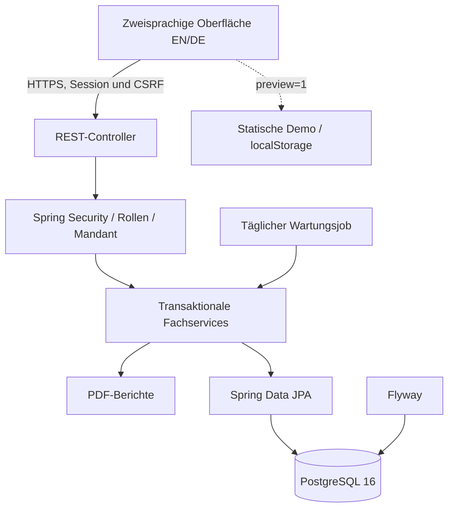
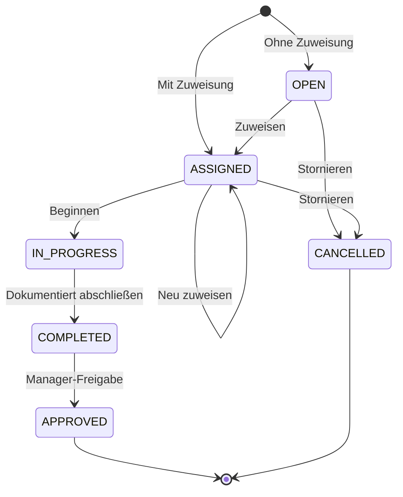
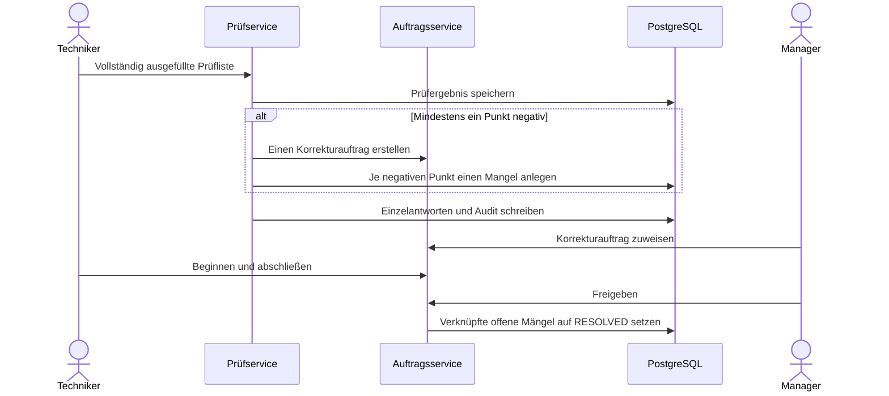

# Technische Architektur und Entwurfsentscheidungen

[English](../en/ARCHITECTURE.md) · [Übersicht](INDEX.md)

## 1. Systemkontext

FacilityFlow ist ein **modularer Spring-Boot-Monolith** mit REST-Schnittstelle und einer direkt ausgelieferten JavaScript-Oberfläche ohne Build-Schritt. PostgreSQL ist die führende Datenhaltung. Für GitHub Pages wird dieselbe Oberfläche über einen Adapter mit synthetischen Browser-Daten betrieben.

**Warum kein Microservice-System?** Ein Portfolio soll sich schnell starten, nachvollziehen, prüfen und deployen lassen. Wartung, Prüfung, Mangel und Freigabe bilden einen stark zusammenhängenden transaktionalen Geschäftsprozess. Eine verteilte Architektur würde in v1 primär unnötige Komplexität erzeugen.

## 2. Pakete und Zuständigkeiten

| Paket | Verantwortung |
|---|---|
| `api/` | Controller, Request-Records, Validierung, Fehlerantworten |
| `security/` | Session, CSRF, BCrypt, Rollen, aktueller Benutzer/Mandant |
| `service/` | Fachregeln, Zustandswechsel, Transaktionen, Scheduler, PDF |
| `domain/` | JPA-Entitäten, stabile Enum-Werte |
| `repository/` | Spring-Data-Abfragen, Mandantenfilter und Sperren |
| `bootstrap/` | Erstadministrator, optionaler lokaler Beispieldatensatz |
| `config/` | Konfigurierbare Uhr und Scheduling |

Die Controller sprechen Fachservices an. Fachservices verwenden Repositories und `CurrentUser`. In der Referenzimplementierung werden einige Entitäten direkt als API-Antworten ausgegeben. Für langfristige Schnittstellenstabilität sind später separate Response-DTOs mit Versionierung und Paginierung sinnvoll.

## 3. Datenmodell

```mermaid
erDiagram
  ORGANIZATION ||--o{ APP_USER : verwaltet
  ORGANIZATION ||--o{ SITE : besitzt
  SITE ||--o{ ASSET : enthaelt
  ASSET ||--o{ MAINTENANCE_PLAN : hat
  MAINTENANCE_PLAN ||--o{ WORK_ORDER : erzeugt
  SITE ||--o{ WORK_ORDER : betrifft
  INSPECTION_TEMPLATE ||--o{ CHECKLIST_ITEM : definiert
  ASSET ||--o{ INSPECTION : geprueft
  INSPECTION_TEMPLATE ||--o{ INSPECTION : verwendet
  INSPECTION ||--o{ INSPECTION_RESULT : speichert
  INSPECTION ||--o{ DEFECT : erkennt
  WORK_ORDER ||--o{ DEFECT : behebt
  ORGANIZATION ||--o{ AUDIT_EVENT : dokumentiert
```

Alle fachlichen Tabellen besitzen UUID, Mandanten-ID und Erstellungszeitpunkt. Fremdschlüssel, Indizes und Eindeutigkeitsbedingungen werden durch `V1__init.sql` angelegt. Flyway führt Schemaänderungen aus; Hibernate überprüft mit `ddl-auto=validate` nur die Übereinstimmung.

Wichtige Datenbankregeln:

- Standort- und Anlagenkennung sind je Mandant eindeutig.
- `(maintenance_plan_id, scheduled_for)` verhindert den zweiten Auftrag desselben Wartungszyklus.
- `(inspection_id, checklist_item_id)` verhindert doppelte Antworten.
- `(template_id, position)` gewährleistet eindeutige Prüflistenpositionen.
- Indizes für Mandant, Status, Fälligkeit und Zeitpunkt helfen den operativen Abfragen.

Die Mandanten-ID wird zur effizienten Filterung in Kindtabellen mitgeführt. Da Fremdschlüssel allein keine mandantengleiche Zuordnung garantieren, prüft die Fachlogik Referenzen ausdrücklich. PostgreSQL-RLS bzw. zusammengesetzte Fremdschlüssel sind mögliche zusätzliche Schutzebenen.

## 4. Statusautomat für Arbeitsaufträge

Diese Übergänge werden in `WorkOrderService` kontrolliert und können nicht über manipulierte Client-Aufrufe umgangen werden. Ein Techniker darf nur ihm zugewiesene Aufträge starten und abschließen; Manager/Administratoren dürfen zusätzlich eingreifen. Zuweisung, Stornierung und Freigabe sind Managerfunktionen.

## 5. Wartungsautomatisierung und Parallelität

1. Pro Wartungsplan werden Anlage, Intervall, Fälligkeit, optionale Zuweisung und Aktivierungsflag gespeichert.
2. Der Scheduler läuft täglich um **03:00 UTC** (per Umgebungsvariable änderbar).
3. Fällige Pläne werden innerhalb einer Transaktion mit `PESSIMISTIC_WRITE` gelesen.
4. Ein Auftrag entsteht nur, wenn der Zyklus noch nicht verarbeitet wurde; zusätzlich schützt die PostgreSQL-Unique-Constraint.
5. Die nächste Fälligkeit wird so oft fortgeschrieben, bis sie in der Zukunft liegt. Versäumte Zyklen werden bewusst **zu einem Nachholauftrag gebündelt**.
6. Manager können den Mechanismus zusätzlich per API für ihren Mandanten anstoßen.

Die konkrete Prüffrist darf nicht pauschal aus der Software abgeleitet werden; die fachlich und rechtlich notwendige Prüfhäufigkeit muss sachkundig bestimmt werden. Für Mehrknoten-HA sind weitere Tests, Scheduler-Koordination und Alarmierung erforderlich.

## 6. Prüfung, Mangel und Korrekturauftrag

Das negative ursprüngliche Prüfergebnis bleibt historisch erhalten. Die Korrektur ändert den Befund nicht rückwirkend. Datenänderungen und Audit-Ereignisse erfolgen innerhalb der jeweiligen Datenbanktransaktion.

## 7. API, Fehler und Transaktionen

Controller verwenden Bean Validation; Services prüfen Identität, fachliche Zuordnung und Status. Falsche Reihenfolgen führen zu HTTP 422, fehlende Berechtigung zu 403, fremde/nicht vorhandene Ressourcen zu 404, fehlende Anmeldung zu 401. Mehrtabellenvorgänge sind mit `@Transactional` abgesichert.

## 8. Oberfläche und Internationalisierung

`app.js` rendert die Oberfläche; `i18n.js` enthält englische und deutsche Texte; `api.js` wählt Server- oder Vorschauadapter; `preview-data.js` simuliert Geschäftsprozesse ohne Benutzerkonto. Englisch ist Standard. Der Browser merkt sich die Sprachauswahl. API-Enums bleiben stabil und sprachneutral; Berichte werden je nach `lang` übersetzt.

## 9. Architekturentscheidungen (ADR)

| ADR | Entscheidung | Begründung / Folge |
|---|---|---|
| ADR-01 | Java 21 und Spring Boot 3.5 | Etablierter Enterprise-Java-Stack; JDK 21 notwendig |
| ADR-02 | Zentrale PostgreSQL-Datenbank | Gemeinsame Transaktion für Prüfung/Mangel/Auftrag; Backups zentral |
| ADR-03 | Flyway und Schema-Validierung | Nachvollziehbare Datenbankentwicklung; keine automatischen DDL-Änderungen |
| ADR-04 | Session und CSRF | Geeignet für Same-Origin-Browseranwendung; HTTPS/Cookies korrekt konfigurieren |
| ADR-05 | Mandantengefilterte Abfragen | Explizite Besitzprüfung; für jede neue API konsequent beachten |
| ADR-06 | Unique Constraint + Sperre | Schutz gegen doppelte Planzyklen; HA benötigt weitere Prüfung |
| ADR-07 | Build-freie Oberfläche mit Demo-Adapter | Einfache öffentliche Recruiter-Demo; langfristig ggf. Komponentenframework |
| ADR-08 | PDF bei Abruf erzeugen | Kein binäres Dokumentenarchiv; Signaturen/Revisionen später ergänzen |

## 10. Grenzen

Nicht integriert sind u. a. eine verteilte Message-Queue, E-Mail-Dienst, produktives Monitoring, automatische Datensicherung, manipulationsgeschütztes Audit, SSO, zertifizierte elektronische Unterschriften und vollständige Barrierefreiheitsprüfung. Siehe [Roadmap](ROADMAP.md) und [Sicherheit](SECURITY.md).
