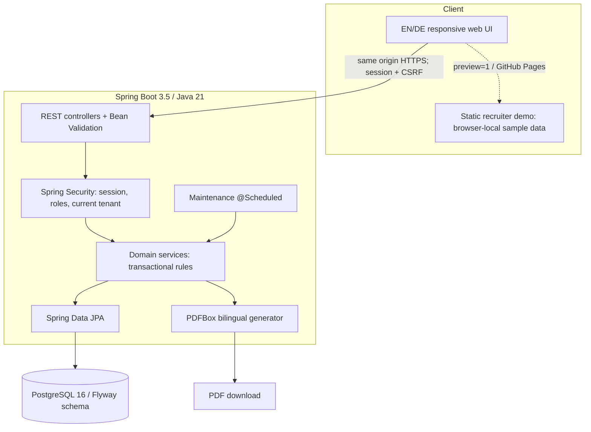
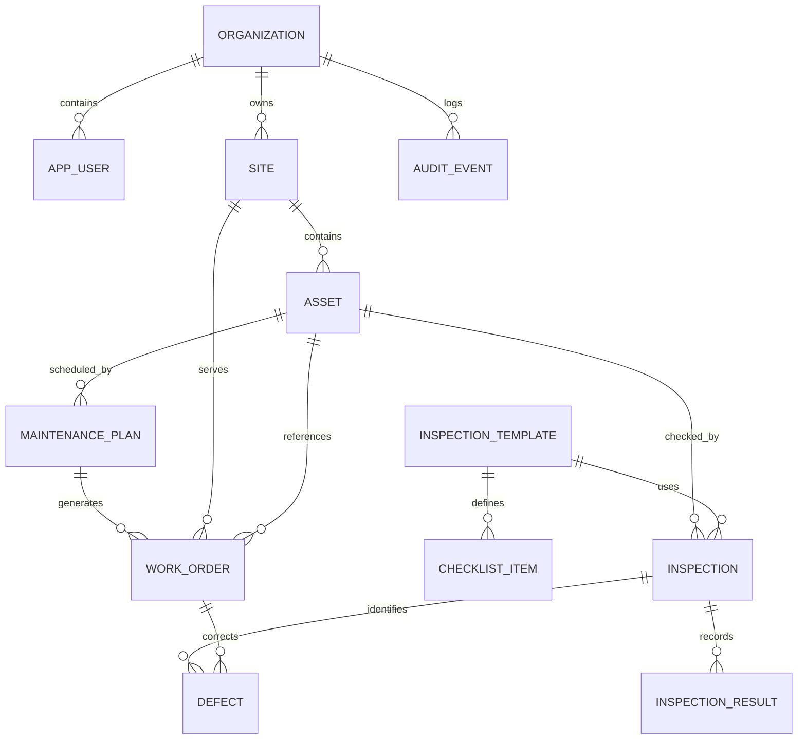
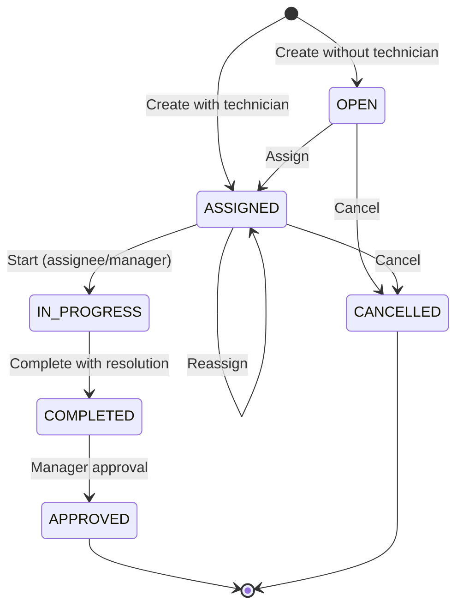

# Technical Architecture & Engineering Decisions

[Deutsch](../de/ARCHITECTURE.md) · [Documentation index](INDEX.md)

## 1. System context

FacilityFlow is one Spring Boot **modular monolith** with REST endpoints and a first-party no-bundler JavaScript front end. PostgreSQL is the authoritative store. A local GitHub Pages adaptation shares the same front-end components but substitutes browser-local synthetic data through an API adapter.



**Why a monolith?** A recruiter can clone, run, debug, test and deploy the full coherent business process with one app and one database. Microservices would introduce distributed-transaction and infrastructure complexity without proven domain scaling requirements.

## 2. Backend packages and dependency direction

```text
api/       REST mapping, request records (Requests.java), exception handling
security/  PrincipalUser, CurrentUser, Spring Security configuration
service/   Business rules, transactions, audit, reports and scheduling
domain/    JPA aggregate records + typed states
repository/ Spring Data JPA query interfaces
bootstrap/ Initial admin and opt-in demo dataset
config/    Clock and scheduling configuration
```

Controllers depend on services; services use repositories and CurrentUser. Persistence entities are returned directly for this portfolio reference, not as stable API response DTOs. **Production evolution:** introduce explicit versioned response schemas and pagination to avoid unintentional API changes when entities change.

## 3. Main persistence model



All operational tables include `organization_id`, `id`, `created_at`. UUIDs are generated in the Java model; PostgreSQL has explicit foreign keys and uniqueness indexes. Referential integrity is enforced by the database. `V1__init.sql` is the first Flyway migration. Hibernate runs `ddl-auto=validate` to prevent schema drift.

Important constraints:

- `UNIQUE (organization_id, code)` in site and asset.
- `UNIQUE (maintenance_plan_id, scheduled_for)` in work_order: prevents duplicated recurrence cycle.
- `UNIQUE (inspection_id, checklist_item_id)` ensures at most one result per template item.
- `UNIQUE (template_id, position)` preserves checklist position.
- Organization/status and date indices accelerate operational dashboards.

**Trade-off:** organization_id is duplicated in child rows for easy scoped queries. Foreign keys alone do not guarantee **cross-tenant identity equality**; service-level checks reject cross-tenant references. For larger/compliance-sensitive deployments, add composite FK or PostgreSQL RLS as defense in depth.

## 4. Work-order finite-state machine



**State transitions are enforced in `WorkOrderService`**, regardless of how an HTTP request is crafted. A technician must be the assigned worker for start/complete (or manager/admin may act). Approval/cancellation/assignment require management role at the controller. A completed work order is not automatically approved.

## 5. Preventive maintenance concurrency

1. A maintenance plan contains asset, interval in days, current due date, optional assignee, and `active` flag.
2. `MaintenanceService.generateScheduled()` executes daily at **03:00 UTC** (property configurable).
3. Database query locks due plans with `PESSIMISTIC_WRITE` within the transaction.
4. For each due plan, a work order is inserted only if the `(plan, scheduled_for)` pair does not already exist. The unique index is the final guard.
5. The next due date advances by the configured period until strictly greater than today. Missed cycles are intentionally collapsed to **one catch-up work order** rather than a potentially huge backlog.
6. An authorized manager may trigger the same logic manually with `POST /api/maintenance-plans/generate-due` (current tenant only).

This is an opinionated portfolio scheduling policy, **not** a universal legal inspection schedule. The required interval must be determined by the operator and qualified personnel. A production distributed deployment should further consider leader election, monitoring, dead-letter handling, and concurrency tests under parallel schedulers.

## 6. Inspection → corrective work process

```mermaid
sequenceDiagram
  actor T as Technician
  participant API as InspectionController
  participant IS as InspectionService
  participant DB as PostgreSQL
  participant WO as WorkOrderService
  participant M as Manager
  T->>API: POST inspection with all answers
  API->>IS: Validate asset, template, item set
  IS->>DB: Save inspection PASS/FAIL
  alt Any failed item
    IS->>WO: Create one corrective work order
    IS->>DB: Save one defect per failed item
  end
  IS->>DB: Save answer snapshots + audit
  IS-->>T: Inspection details + linked defects
  M->>WO: Assign corrective order
  T->>WO: Start; complete with resolution
  M->>WO: Approve
  WO->>DB: Resolve linked open defects in same transaction
```

The snapshot of an inspection is kept even after corrective closure. This preserves the fact that a failure was observed at an earlier date.

## 7. Transactions, isolation and error handling

`@Transactional` surrounds create/update/multi-table business changes. A failed inspection and its corrective work order/defects are one database transaction: no partial commit. HTTP request validation uses `jakarta.validation` and service checks. Invalid domain transitions return 422; access denial 403; cross-tenant/not-found 404; unauthenticated access 401. See [API](API.md).

`AuditService` writes events in the current business transaction, ensuring a roll-back removes uncommitted history alongside the business change. Audit events are append-oriented at the application level but **not tamper-proof** against privileged database users; WORM or external append-only event logging is future work.

## 8. Locale, reporting and front end

No JavaScript framework, build step, CDN or external font dependency is required. `app.js` renders role-sensitive screens, `i18n.js` contains EN/DE dictionaries and label translation, and `api.js` chooses real REST calls or `preview-data.js` simulation. English is the default; a local storage choice selects German. The backend stores invariant statuses (`ASSIGNED`, `APPROVED`) and generates PDF labels in requested language.

The UI is same-origin; static resources are publicly readable while `/api/**` requires login except `/api/auth/login` and `/api/auth/csrf`. The public Pages demo does not use PostgreSQL or authenticate real users.

## 9. Architecture Decision Records

| ADR | Decision | Reason | Consequence |
|---|---|---|---|
| ADR-01 | Java 21 + Spring Boot 3.5.x | Widely relevant German enterprise Java stack | JDK21 runtime required |
| ADR-02 | One PostgreSQL database | Transactional consistency across repairs/defects/inspection | Backups and scaling centralized |
| ADR-03 | Flyway migrations + Hibernate validate | Repeatable schema changes and CI validation | Schema changes require migrations |
| ADR-04 | Cookie session + CSRF | First-party browser web app | Must correctly secure cookies/HTTPS |
| ADR-05 | Tenant-scoped repository lookups | Simple explicit data ownership | Requires careful discipline across new endpoints |
| ADR-06 | Database uniqueness + pessimistic lock | Prevent duplicate planned work | Multi-node job operations require further HA review |
| ADR-07 | No-build UI with local preview adapter | Zero-setup recruiter demo, no secret APIs | Complex UI growth would justify component framework |
| ADR-08 | Generate PDFs on demand | Portable reports without stored binary documents | Advanced signatures, versioning and archival missing |

## 10. Operational boundaries

No distributed queue, email system, production-grade file storage, observability stack, backups automation, SSO, accessibility certification or e-signature is bundled. Read [Roadmap](ROADMAP.md) and [Security](SECURITY.md) before any production pilot.
